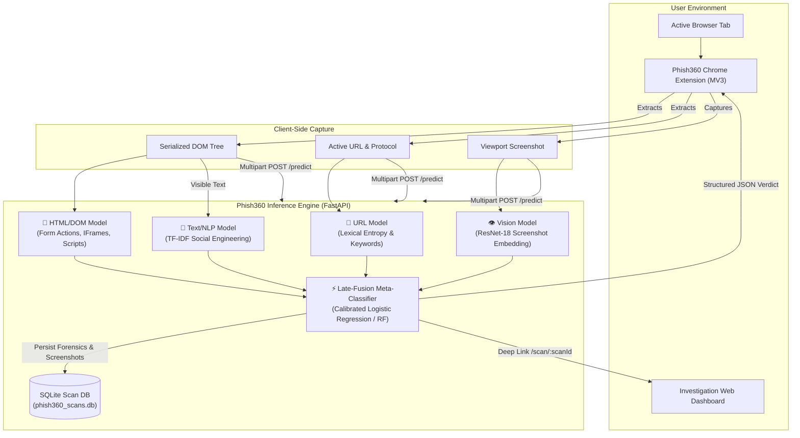

# 🛡️ Phish360 — Multimodal AI Phishing Defense Platform

<div align="center">


### *Next-Generation Multimodal Cyber Defense: Fusing URL, DOM, Text & Vision Signals*

[](https://react.dev/)
[](https://www.typescriptlang.org/)
[](https://fastapi.tiangolo.com/)
[](https://pytorch.org/)
[](https://developer.chrome.com/docs/extensions/mv3/intro/)
[](https://threejs.org/)
[](https://tailwindcss.com/)

[Overview](#-overview) •
[Architecture](#-system-architecture) •
[Quick Start](#-quick-start) •
[Chrome Extension](#-chrome-extension) •
[Web Dashboard](#-security-investigation-dashboard) •
[ML Modalities](#-multimodal-ml-pipeline) •
[API Reference](#-api-reference)

---

</div>

## 📌 Overview

**Phish360** is an end-to-end, multi-tier phishing detection and threat investigation suite. While conventional phishing detectors examine URLs in isolation or rely solely on blacklists, Phish360 simultaneously evaluates **four distinct attack vectors** using machine learning and deep vision to catch zero-day credential harvesting sites, brand impersonation, and evasive adversarial attacks.

The platform provides a **three-part ecosystem**:
1. 🧠 **Multimodal Inference Engine**: A FastAPI microservice combining lexical URL analysis, DOM structure heuristics, NLP-driven semantic text classification, and ResNet-18 computer vision embeddings into a calibrated decision-fusion ensemble.
2. 💻 **Forensic Investigation Dashboard**: A reactive React/Vite cockpit featuring an interactive **Three.js 3D Decision Core**, draggable forensic inspection windows, explainability meters, and historical audit logs.
3. 🧩 **Manifest V3 Chrome Extension**: A high-tech browser extension that scans live tabs with a single click, captures viewport screenshots and DOM trees locally, and provides instantaneous threat telemetry.

---

## 🏛️ System Architecture



---

## 🚀 Quick Start

### Prerequisites
* **Python 3.10+**
* **Node.js 18+** & `npm`
* Modern Chromium-based browser (Chrome, Brave, Edge)

---

### 1. Start the Machine Learning Backend

```bash
# Navigate to the backend directory
cd backend

# Create and activate a virtual environment
python -m venv .venv
# Windows:
.venv\Scripts\activate
# Linux / macOS:
# source .venv/bin/activate

# Install core dependencies
pip install -r requirements.txt

# (Recommended for full vision model): Install PyTorch CPU
pip install torch torchvision --index-url https://download.pytorch.org/whl/cpu

# Start the API server on port 8000
python -m uvicorn api.app:app --reload --port 8000
```
> **Backend Online**: Verify by opening `http://localhost:8000/health` or `http://localhost:8000/docs` in your browser.

---

### 2. Launch the Web Dashboard

```bash
# Open a new terminal and navigate to frontend
cd frontend

# Install dependencies
npm install

# Run the development server
npm run dev
```
> **Dashboard Online**: Open **`http://localhost:5173`** in your browser.

---

### 3. Load the Chrome Extension

1. Open your browser and navigate to `chrome://extensions/`.
2. Toggle on **Developer mode** (top right switch).
3. Click **Load unpacked** (top left).
4. Select the `extension/` folder located in this repository:
   ```text
   Phishing/extension/
   ```
5. Pin **Phish360** to your browser toolbar! Click the shield icon on any webpage to scan.

---

## 🧩 Chrome Extension Features

The Phish360 Chrome Extension provides real-time threat intelligence right inside your browser window:

* **Sleek Cyber Defense UI**: Dark glassmorphic aesthetic matching the Phish360 design system.
* **Real-Time Backend Heartbeat**: Dynamic status pill showing whether the local or remote inference engine is connected (`API Online` / `API Offline`).
* **Target Security Check**: Automatic protocol inspection verifying `HTTPS` security certificates or warning against insecure `HTTP` pages.
* **Animated Sonar Scanning Radar**: High-tech rotating radar animation with a live 4-stage pipeline telemetry tracker (`DOM` → `Vision` → `Features` → `Ensemble`).
* **Tri-Tier Security Verdict**:
  * 🟢 **Safe / Legitimate**: Confirmed authentic structure, clean DOM, and trusted domain.
  * 🟡 **Suspicious / Anomaly**: Irregular forms, elevated domain entropy, or mismatched brand logos.
  * 🔴 **Critical Phishing**: High-confidence credential harvesting attempt or deceptive cloned interface.
* **Multimodal Signal Meters**: Real-time percentage breakdowns for URL, HTML, Text, and Vision models.
* **Configurable Endpoints Drawer**: Click the settings gear to change the API and Frontend URLs on the fly (persisted via `chrome.storage`), making it seamless to transition from `localhost` to remote cloud deployments (e.g., Render, Railway, AWS).
* **One-Click Forensic Deep Link**: Launches directly into `/scan/:scanId` on the Web Dashboard for full forensic auditing.

---

## 💻 Security Investigation Dashboard

The web dashboard is an interactive command center built for security analysts, incident responders, and researchers:

| Feature | Description |
| :--- | :--- |
| **3D Decision Core** | Real-time WebGL interactive scene built with Three.js (`@react-three/fiber`), visualizing multi-agent signal particles flowing from 4 modality nodes into a morphing core sphere. |
| **Draggable Modality Windows** | Mac-style floating forensic panels with full draggable headers, displaying raw DOM metrics, token importance, and screenshot comparisons. |
| **Ablation & Research Studio** | Interactive research suite comparing single-modality vs. multimodal ensemble contribution, loss curves, and confusion matrices. |
| **Historical Scan Database** | Searchable archive of all historical scans with direct screenshot replay, per-model scores, and JSON export. |
| **Explainable AI (XAI)** | Transparent confidence breakdowns highlighting why a particular page was flagged as phishing. |

---

## 🔬 Multimodal ML Pipeline

Phish360 uses an ensemble architecture where each model specializes in an independent attack surface:

```
+-------------------------------------------------------------------------------+
|                             RAW TARGET WEBPAGE                                |
+-------------------------------------------------------------------------------+
       |                         |                       |              |
       v                         v                       v              v
 [ URL String ]           [ DOM Hierarchy ]       [ Visible Text ]  [ Screenshot ]
       |                         |                       |              |
       v                         v                       v              v
+--------------+          +--------------+        +--------------+ +--------------+
|  URL Model   |          |  HTML Model  |        |  Text Model  | | Vision Model |
|  • Length    |          |  • Forms     |        |  • TF-IDF    | | • ResNet18   |
|  • Entropy   |          |  • IFrames   |        |  • Urgency   | |   512-d Vec  |
|  • IP Host   |          |  • External  |        |  • Lures     | | • Visual     |
|  • Keywords  |          |    Scripts   |        |  • Bi-grams  |   Cloning      |
+--------------+          +--------------+        +--------------+ +--------------+
       \                         |                       |             /
        \                        |                       |            /
         v                       v                       v           v
       [P_url]                 [P_html]                [P_text]    [P_vision]
          \                      |                       |            /
           \---------------------+-----------------------+-----------/
                                 |
                                 v
               +-----------------------------------+
               |  LATE-FUSION DECISION ENSEMBLE    |
               |  (Logistic Regression Meta-Model) |
               +-----------------------------------+
                                 |
                                 v
                FINAL VERDICT: LEGITIMATE / PHISHING
```

### Modality Specifications:
1. **URL Lexical Model** (`src/features_url.py`):
   * Extracts Shannon entropy, URL length, subdomain depth, digit ratios, IP-in-hostname patterns, and known phishing target keyword presence.
   * Completely offline, non-blocking evaluation with zero network requests.
2. **HTML / DOM Structural Model** (`src/features_html.py`):
   * Analyzes form action destinations, password input counts, hidden elements, `iframe` presence, external script/link ratio, and meta-refresh tags.
3. **Text / NLP Model** (`src/train_modality.py`):
   * Extracts visible inner text, sanitizes markup, and computes TF-IDF n-gram vectors (1-2 grams) trained to detect urgency keywords, security threats, and credential deception.
4. **Vision / CNN Model** (`src/features_vision.py`):
   * Passes the captured screenshot through a frozen pretrained **ResNet-18** convolutional neural network to yield a 512-dimensional visual embedding (with automatic fallback to color-histogram features if PyTorch is omitted).
5. **Ensemble Fusion Classifier** (`src/train_fusion.py`):
   * Aggregates the posterior probabilities through a calibrated meta-estimator that intelligently falls back to available subsets if any modality is absent.

---

## 📡 API Reference

The backend exposes a high-performance REST API documented via OpenAPI / Swagger:

### `POST /predict`
Run inference across uploaded modalities.

**Parameters (multipart/form-data):**
* `url` *(string, required)*: The URL to evaluate.
* `html` *(string, optional)*: Serialized outer HTML string of the webpage.
* `screenshot` *(file, optional)*: PNG or JPEG screenshot of the rendered page.
* `allow_fetch` *(boolean, default: false)*: When `true`, securely fetches HTML server-side with SSRF protection.

**Sample Response:**
```json
{
  "scan_id": "9b1deb4d-3b7d-4bad-9bdd-2b0d7b3dcb6d",
  "predicted_label": "phishing",
  "phishing_probability": 0.942,
  "threshold": 0.5,
  "per_modality_scores": {
    "url": 0.884,
    "html": 0.962,
    "text": 0.731,
    "vision": 0.915
  },
  "created_at": "2026-10-11T19:20:00Z"
}
```

### Additional Endpoints:
* `GET /health` — Health check reporting status and available ML models.
* `GET /scans` — Retrieve paginated list of recent historical scans.
* `GET /scans/{scan_id}` — Fetch detailed forensics and feature matrices for a specific scan.
* `GET /scans/{scan_id}/screenshot` — Serve the saved screenshot associated with a scan.
* `GET /model-info` — Inspect model architectures, input dimensions, and hyperparameters.

---

## 📂 Repository Structure

```text
Phishing/
├── backend/
│   ├── api/
│   │   ├── app.py                  # FastAPI REST API & endpoints
│   │   ├── db.py                   # SQLite persistence & query helpers
│   │   └── safe_fetch.py           # SSRF-guarded server-side web client
│   ├── src/
│   │   ├── features_url.py         # URL lexical feature extractor
│   │   ├── features_html.py        # DOM & HTML structural feature parser
│   │   ├── features_vision.py      # ResNet-18 screenshot embedding pipeline
│   │   ├── train_modality.py       # Single-modality trainer scripts
│   │   ├── train_fusion.py         # Meta-classifier late-fusion trainer
│   │   └── ablation.py             # Ablation experiment runner
│   ├── models/                     # Serialized .joblib model binaries
│   ├── datasets/                   # Training splits and datasets
│   └── requirements.txt            # Python dependencies
│
├── frontend/
│   ├── src/
│   │   ├── components/
│   │   │   ├── scan/
│   │   │   │   ├── fusion3d/       # Three.js 3D Decision Core
│   │   │   │   └── ModalityWindow.tsx # Draggable forensic window
│   │   │   └── layout/             # Glassmorphic AppShell & navigation
│   │   ├── routes/                 # Scan, History, Models, Research pages
│   │   └── index.css               # Design system & dark theme tokens
│   ├── public/                     # Favicons & PWA web assets
│   ├── package.json
│   └── vite.config.ts
│
├── extension/
│   ├── manifest.json               # Manifest V3 extension configuration
│   ├── popup.html                  # Upgraded cyber-defense popup layout
│   ├── popup.css                   # Glassmorphic CSS styling & radar animation
│   ├── popup.js                    # Telemetry capture & scan controller
│   └── icons/                      # High-res extension icons (16, 32, 48, 128)
│
├── generate_icons.py               # Automated icon generator script
└── README.md                       # Master documentation (this file)
```

---

## 🛡️ Security & Privacy Notice

* **Zero Cloud Leak by Default**: By default, the extension captures DOM and screenshots locally within your browser and transmits them directly to your designated API endpoint.
* **SSRF Guardrails**: The optional backend crawler (`api/safe_fetch.py`) blocks private IP ranges (`10.0.0.0/8`, `192.168.0.0/16`, `127.0.0.1`), enforces redirect hop limits, and validates MIME types.

---

## 📄 License

This project is licensed under the MIT License — feel free to modify, extend, and deploy in your own security operations center (SOC) or research lab.
